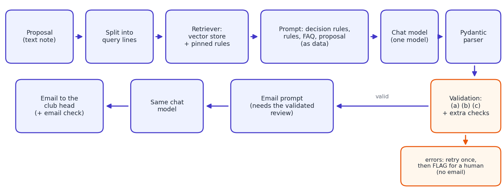

# Club Event Proposal Reviewer

A small RAG pipeline that reads an informal club event proposal, checks it against a college rulebook, and returns a **structured review** (verdict plus rule violations) and a **polite email** to the club head.

Built with LangChain, Pydantic and a local vector store for the Brightvale College Club Council exercise (fictional college, clubs and rules).



## What it does

For every proposal the pipeline:

1. splits the note into one query per line and retrieves the matching rules and FAQ answers from a vector store;
2. builds a prompt from the decision rules, the retrieved rules, the FAQ and the proposal (treated as data, not instructions);
3. asks one chat model for a review and parses it into a Pydantic `ProposalReview`;
4. validates the review in plain Python, retries once on errors, and flags it for a human if it still fails;
5. passes a validated review to a second prompt that writes the email.

A review contains `club_name`, `event_name`, `event_date`, a `verdict` (`Approve`, `Needs changes`, `Reject`), a list of violations (`rule_id`, `severity`, `evidence`, `fix`) and a one-sentence `summary`.

## Repository layout

```
.
├── notebooks/
│   └── club_proposal_reviewer.ipynb   # the whole project, top to bottom
├── data/
│   ├── knowledge_base/                # rulebook (22 rules) and reviewer FAQ (11 answers)
│   ├── proposals/                     # P01 to P13, the evaluation set
│   └── my_proposals/                  # one clean and one tricky proposal for testing
├── docs/
│   ├── report.docx                    # written report
│   └── pipeline.png                   # pipeline diagram
├── results/                           # cached review results (JSON, not committed by default)
├── requirements.txt
├── .env.example
├── .gitignore
└── LICENSE
```

## Setup

```bash
git clone <this-repo-url>
cd club-proposal-reviewer

python -m venv .venv
source .venv/bin/activate            # Windows: .venv\Scripts\activate
pip install -r requirements.txt
pip install langchain-anthropic      # or langchain-openai, langchain-google-genai, langchain-groq
```

Choose the chat model in the config cell of the notebook (`CHAT_PROVIDER`, `CHAT_MODEL`). Embeddings run locally with `sentence-transformers/all-MiniLM-L6-v2`, so Steps 1 to 5 need no API key.

**API key.** Either create a `.env` file from `.env.example`, or just run the notebook and paste the key into the hidden prompt that appears in Step 6. The key is never written into the notebook. `.env` is git-ignored.

```bash
cp .env.example .env                 # then fill in the key for your provider
jupyter notebook notebooks/club_proposal_reviewer.ipynb
```

Run the cells one at a time. Free API tiers have rate limits, so the evaluation in Step 9 is split into small batches and caches each result in `results/`.

## Design decisions

**Chunking: one rule per chunk.** I tried `RecursiveCharacterTextSplitter` on the rulebook (longest rule: 342 characters):

| chunk size (overlap 0) | chunks | rules kept whole (of 22) | rules cut | chunks mixing 2+ rules |
|---|---|---|---|---|
| 150 | 51 | 9 | 13 | 0 |
| 300 | 23 | 21 | 1 | 4 |
| 500 | 14 | 22 | 0 | 9 |
| 1000 | 6 | 22 | 0 | 5 |

Sizes big enough to keep every rule whole also glue neighbouring rules together, so size alone cannot give one rule per chunk. The rulebook and FAQ are written one rule or answer per paragraph, so the notebook splits on that structure: 22 rule chunks and 11 FAQ chunks, with a 400-character cap as a safety net. The "how a proposal is decided" section is always included in the prompt rather than retrieved.

**Retrieval query and pinned rules.** One query for a whole proposal blurs many topics together, so the note is split into one query per line and the top-`k` hits per query are merged. Retrieval can only search text that exists, so it cannot find a rule about something a note *leaves out* (required details R-02, venue booking R-12, report status R-22), and a bare date shares no words with the exam-week rule. These rules (R-01 to R-05, R-12, R-22) and three FAQ answers are therefore pinned into every prompt. Step 4 of the notebook compares the strategies on recall and prompt size.

**Validation in plain Python.** After every review the code checks that each `rule_id` exists, that the verdict matches the most severe violation (using the rulebook's severities, not the model's), that the output parses, that severities match the rulebook, that no rule is listed twice and that evidence and fix are not empty. A rule that is cited but was not retrieved is recorded as a warning (a possible retrieval gap), not an error. Errors trigger one retry with feedback; a second failure is marked `FLAGGED_FOR_HUMAN` and no email is written.

**Computed facts (optional experiment).** Language models are weak at date arithmetic and adding up budgets. `extract_facts` computes weekdays, days of notice, budget sums and percentages, volunteers needed and capacity limits in plain Python and passes them to the prompt as a `<computed_facts>` block. The notebook evaluates the reviewer with and without it.

**One chat model.** The same model object serves the review chain and the email chain.

## Results

> TODO: fill in after running the notebook with your chosen model.

| run | verdict accuracy | expected rules found | false alarms | retried | flagged |
|---|---|---|---|---|---|
| baseline (RAG) | | | | | |
| + computed facts | | | | | |
| whole rulebook in prompt | | | | | |

The comparison key in the notebook (`MY_HAND_KEY`) is hand-derived, not official. Set `ANSWER_KEY` to the official key to score against it.

## Limitations

- Output quality depends on the configured model; temperature is 0 but runs can still vary slightly.
- The computed-facts helper assumes the "Label: value" layout used in the sample notes.
- The rulebook is short enough to fit in one prompt, so RAG mainly saves prompt space here; the notebook measures whether it also changes quality.
- The vector store is in memory and rebuilt on every run.

## Dataset

The rulebook, FAQ and proposals P01 to P13 come from the course exercise and are entirely fictional. If you publish this repository, check that your course allows redistributing them; otherwise remove `data/knowledge_base` and `data/proposals` and add them to `.gitignore`.

## AI assistance

This project was developed with assistance from Claude (Anthropic). [Describe what you wrote, changed and verified yourself, and keep this note accurate and consistent with your course's policy on AI tools.]

## License

MIT, see [LICENSE](LICENSE).
